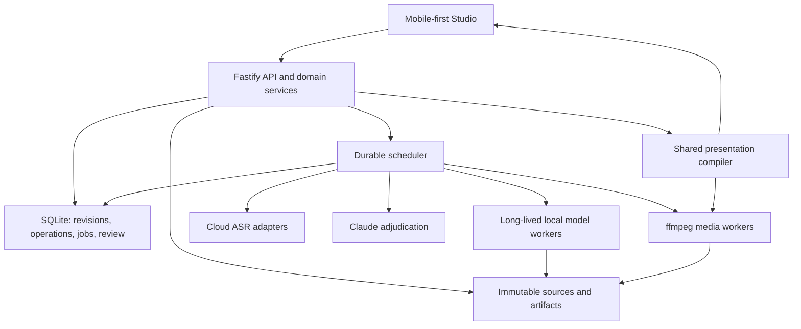

# Titler: greenfield architecture and implementation plan

## Findings (salvage/avoid)

**Build a new application around immutable media artifacts, revisioned transcripts, durable jobs, pluggable recognition providers, and a mobile-first editor.** The existing application is a reference implementation and a source of regression cases. Its routes, storage format, component hierarchy, and deployment structure do not constrain the new design.

The owner’s greenfield direction supersedes the incremental-development wording in `docs/spec-workflow.md:137`. The workflow and acceptance requirements remain authoritative, especially “Первый рабочий цикл” at `docs/spec-workflow.md:149`.

This is a read-only review. No repository files were changed. Findings come from the files inspected during this review. In-memory checks confirmed the caption chunker’s trailing-word loss and the ASS timestamp rollover defect. Browser behavior, media quality, hardware acceleration, and provider accuracy have not been benchmarked here.

### Core lessons

| Area | Established finding | New-design requirement |
|---|---|---|
| Manual edits versus ASR | ASR completion replaces the editable transcript without checking its revision. | Hypotheses and authoritative text must be separate entities. |
| Cache identity | Mutable filenames and style flags substitute for source/parameter/model cache keys. | Every processing result needs explicit immutable inputs and provenance. |
| Word identity | Words have text, intervals, and optional probability; no stable IDs or review/timing status. | Stable word identity and separate text, timing, and review provenance. |
| Restart recovery | Jobs exist in memory. | Durable jobs, attempts, leases, and recoverable results. |
| Editing | Per-word inputs, hover actions, and narrow insertion gaps limit keyboard and touch use. | A real document editor with word-linked annotations and explicit touch actions. |
| Export | Preview and export differ; filenames collide; render freshness is incorrect. | Immutable render manifests and shared presentation semantics. |

Evidence: `server/src/transcribe.ts:82`, `server/src/jobs.ts:31`, `server/src/jobs.ts:110`, `server/src/types.ts:4`, `studio/src/components/TranscriptEditor.tsx:228`, and `server/src/renderFfmpeg.ts:46`.

### `server/src/main.ts`

**Salvage:** the useful product operations—project registration, media delivery, transcript editing, processing progress, screenshots, and export. Fastify remains a reasonable transport choice.

**Avoid:**

- Two processing paths: request-bound subprocess execution and separately queued jobs. Direct ingest, ASR, crop, and render routes bypass queue limits and durable tracking. See `server/src/main.ts:268`, `server/src/main.ts:285`, `server/src/main.ts:306`, and `server/src/main.ts:522`.
- Full-array transcript replacement without revision checks. Invalid entries are silently discarded, while negative or reversed intervals are not rejected. See `server/src/main.ts:201`.
- Writing `transcript.json` and project JSON separately. These are two mutable copies without a transaction. See `server/src/main.ts:217`.
- Blocking ffmpeg execution inside the screenshot route. See `server/src/main.ts:150`.
- Treating an inbox pathname as an upload. The existing creation routes require a file already under `in/`. See `server/src/main.ts:232` and `server/src/main.ts:445`.
- Assuming `/events` provides job recovery: it forwards inbox notifications and keepalives, without persisted event cursors. See `server/src/main.ts:583`.

The new API should validate commands, transact short changes, and submit durable jobs. Processing must not depend on an HTTP connection remaining open.

### `server/src/jobs.ts`

**Salvage:** separate resource limits for media work and inference. The existing two queues recognize that these workloads should not completely block one another (`server/src/jobs.ts:33`).

**Avoid:**

- The in-memory `Map` and queues disappear on server restart. See `server/src/jobs.ts:31`.
- Render style and ASR options live in an asynchronous closure rather than a persistent job specification. See `server/src/jobs.ts:19` and `server/src/jobs.ts:52`.
- A style name is treated as evidence that a render is current. Editing subtitles, changing crop, or deleting the output does not invalidate this condition. See `server/src/jobs.ts:110`.
- No persisted attempts, leases, cancellation, input revisions, artifact results, or deduplication identity. See `server/src/jobs.ts:19`.
- Individual resource queues do not prevent conflicting work on the same mutable project files. See `server/src/jobs.ts:69`.

Browser closure independence is useful, but it is not restart durability.

### `server/src/projects.ts` and `server/src/types.ts`

**Salvage:** simple project identity, source metadata, and the separation between transcript text and manually positioned overlays.

**Avoid:**

- Direct synchronous JSON overwrites as the authoritative transaction mechanism. See `server/src/projects.ts:31`.
- Storing only an external source pathname; the application does not establish immutable ownership of the source bytes. See `server/src/projects.ts:12`.
- A single project-wide `edited` flag and a list of rendered styles as correctness metadata. See `server/src/types.ts:77`.
- Words without stable IDs, text provenance, timing provenance, alternatives, or review status. See `server/src/types.ts:4`.
- One file-level language field as the only language representation. See `server/src/types.ts:11`.

The new model should not reproduce these limitations merely to import existing project JSON. Legacy import is optional and outside the first release.

### `server/src/transcribe.ts` and `scripts/transcribe.py`

**Salvage:** the existing MLX/faster-whisper adapter experience, optional language and vocabulary hints, word timestamp extraction, and large-v3 baseline. See `scripts/transcribe.py:35`, `scripts/transcribe.py:60`, and `scripts/transcribe.py:115`.

**Avoid:**

- **Confirmed overwrite path:** recognition writes `work/<id>/transcript.json`, the same file modified by manual edits, then unconditionally replaces `project.transcript`. See `server/src/transcribe.ts:35`, `scripts/transcribe.py:203`, `server/src/main.ts:219`, and `server/src/transcribe.ts:82`.
- Spawning and loading an inference environment for each request. Faster-whisper constructs its model during the invocation. See `server/src/transcribe.ts:49` and `scripts/transcribe.py:114`.
- Recording backend identity without resolved weights, model revision, effective decoding parameters, and input audio identity. See `scripts/transcribe.py:86` and `scripts/transcribe.py:145`.
- Treating ASR word timestamps as post-edit alignment. These are different jobs with different inputs.
- Treating multiple runtimes of the same Whisper model as independent recognizers.

The frontend’s warning that retranscription loses edits is evidence of the current behavior, not an acceptable protection mechanism (`studio/src/App.tsx:643`).

### `server/src/ingest.ts`

**Salvage:** ffprobe metadata extraction, ffmpeg process handling, progress parsing, and Telegram-circle detection as an optional media classifier.

**Avoid:**

- Coupling source preparation, framing, full video encoding, and ASR audio extraction. Audio extraction waits for the video encode. See `server/src/ingest.ts:114` and `server/src/ingest.ts:148`.
- Baking a 9:16 frame into the primary working video before editing. See `server/src/ingest.ts:22`.
- Repeating audio extraction when crop changes. See `server/src/main.ts:327` and `server/src/ingest.ts:148`.
- Reusing mutable `source.mp4` and `audio.wav` destinations. See `server/src/ingest.ts:76`.
- Using the mono 16 kHz ASR derivative as the only separate audio representation. Listening, enhancement, and export need a full-band master. See `server/src/ingest.ts:148`.
- Allowing optional audio in video normalization but requiring it unconditionally in the next stage. Silent media needs an explicit supported state. See `server/src/ingest.ts:90` and `server/src/ingest.ts:150`.

### `server/src/assGen.ts`

**Salvage:** ASS as an efficient subtitle export format; phrase grouping informed by pauses and punctuation; style examples as visual references.

**Avoid:**

- Duplicated chunking policy between server and Remotion. See `server/src/assGen.ts:24` and `remotion/src/lib/chunk.ts:19`.
- **Confirmed word loss:** the final flush can defer a trailing weak word into a buffer that is never emitted. The input `я`, `и` produced only `я` in both implementations. See `server/src/assGen.ts:80`, `server/src/assGen.ts:140`, `remotion/src/lib/chunk.ts:75`, and `remotion/src/lib/chunk.ts:139`.
- **Confirmed timestamp defect:** `59.999` seconds can become `0:00:60.00`. Round total centiseconds before decomposing the timestamp. See `server/src/assGen.ts:178`.
- Direct interpolation of user text into ASS override syntax. Literal braces, backslashes, and line breaks need escaping. See `server/src/assGen.ts:263`, `server/src/assGen.ts:325`, and `server/src/assGen.ts:377`.
- Hardcoded dimensions, fonts, positions, and wrapping heuristics without actual text-bound validation. See `server/src/assGen.ts:67`, `server/src/assGen.ts:225`, and `server/src/assGen.ts:466`.
- Silent text normalization inside rendering. Rejoining number tokens changes the presentation’s textual interpretation without an edit operation. See `server/src/assGen.ts:28`.

### `server/src/renderFfmpeg.ts`

**Salvage:** ffmpeg/ASS export, streaming progress, and a downloadable MP4 result.

**Avoid:**

- **Output collisions:** filenames contain recording time to the second and style, without project or revision identity; `-y` overwrites the destination. See `server/src/renderFfmpeg.ts:46` and `server/src/renderFfmpeg.ts:73`.
- Shared subtitle filenames for concurrent renders. See `server/src/renderFfmpeg.ts:33`.
- Re-encoding the already framed proxy instead of rendering a complete immutable plan from source-quality media. See `server/src/renderFfmpeg.ts:74`.
- Implicitly exporting embedded original audio instead of explicitly mapping the selected variant. See `server/src/renderFfmpeg.ts:72`.
- Declaring success solely from ffmpeg’s exit code. See `server/src/renderFfmpeg.ts:114`.
- Rendering from mutable project state without recording exactly which transcript, framing, style, audio, and overlays were used.

### `server/src/render.ts`

**Salvage:** the concept of an alternate render implementation for diagnostic comparisons.

**Avoid:** carrying two implicit production exporters. Active routes use ffmpeg, while this headless Remotion path has different filenames and omits overlay/watermark inputs. See `server/src/main.ts:534`, `server/src/jobs.ts:116`, `server/src/render.ts:48`, and `server/src/render.ts:64`.

The new app should have one authoritative export service. Alternative renderers can exist only behind an explicit testing interface.

### `server/src/crop.ts`, `scripts/face_track.py`, and `server/src/aspect.ts`

**Salvage:** source-coordinate crop geometry, smoothing concepts, circle framing, and automatic region suggestions.

**Avoid:**

- Calling a static crop “tracking.” Python generates keyframes, but the filter reduces them to median X and ignores time and Y. See `scripts/face_track.py:185`, `server/src/aspect.ts:54`, and `server/src/aspect.ts:76`.
- Using the largest face as a universal subject selector for POV footage. See `scripts/face_track.py:147` and `docs/spec-workflow.md:89`.
- A framing option that has no effect for the selected strategy. Landscape blur-fill does not consume face-track data. See `server/src/aspect.ts:44` and `server/src/aspect.ts:91`.
- Incorrect cover geometry for sources narrower than 9:16: scaling only to height can produce a width smaller than the requested crop. See `server/src/aspect.ts:47` and `server/src/aspect.ts:84`.
- A subprocess protocol that relies on one stdout chunk being exactly `DONE`; successful process exit without that chunk never resolves. See `server/src/crop.ts:41` and `server/src/crop.ts:62`.

Manual framing and keyframes must be first-class. Automatic analysis only proposes them.

### `studio/src/App.tsx`

**Salvage:** readable transcript presentation, project navigation, playback integration, batch concepts, and the distinction between deleting subtitle text and cutting video.

**Avoid:**

- A single component owning network synchronization, document edits, playback, batch processing, export naming, SRT generation, and layout.
- Saving without checking HTTP status. See `studio/src/App.tsx:475`.
- Full-document writes and fresh-project responses replacing newer local edits without revision guards. See `studio/src/App.tsx:496` and `studio/src/App.tsx:256`.
- Estimating inserted-word timing from character counts and playhead position, then assigning `prob: 1`. Multiword input also becomes one word record. See `studio/src/App.tsx:537`.
- Automatic one-second playback on a word click. See `studio/src/App.tsx:392`.
- Session-global style, watermark, and last-output state instead of project-versioned configuration. See `studio/src/App.tsx:177`.
- Job polling that starts only after local state already contains an active job. See `studio/src/App.tsx:194` and `studio/src/App.tsx:286`.
- Fixed `280px 1fr 360px` columns with hidden overflow as a phone layout. See `studio/src/App.tsx:828`.
- Treating a stream closing without output as “render complete,” even when an error event was emitted. See `studio/src/App.tsx:436` and `studio/src/App.tsx:451`.

Preserve the current deletion semantics: subtitle edits do not cut video (`studio/src/App.tsx:507`).

### `studio/src/components/TranscriptEditor.tsx`

**Salvage:** sentence grouping, audio-linked words, active-word highlighting, and prose rather than a wall of buttons. See `studio/src/components/TranscriptEditor.tsx:40` and `studio/src/components/TranscriptEditor.tsx:50`.

**Avoid:**

- Array indices as editing identities and index/time combinations as component keys. See `studio/src/components/TranscriptEditor.tsx:15` and `studio/src/components/TranscriptEditor.tsx:222`.
- Double-click editing, hover-only 14 px deletion controls, and 0.35 em insertion gaps. See `studio/src/components/TranscriptEditor.tsx:228`, `studio/src/components/TranscriptEditor.tsx:275`, and `studio/src/components/TranscriptEditor.tsx:300`.
- Missing insertion targets at transcript boundaries and in an empty transcript. See `studio/src/components/TranscriptEditor.tsx:298`.
- Isolated per-word inputs without document-level cursor movement, range replacement, split/merge, or undo. See `studio/src/components/TranscriptEditor.tsx:102`.
- Enter committing during keyboard composition. See `studio/src/components/TranscriptEditor.tsx:124`.
- Auto-scroll that pauses for editing but not for manual reading elsewhere. See `studio/src/components/TranscriptEditor.tsx:66`.

Keyboard handling needs nuance: the existing global handler correctly excludes native input, textarea, and select targets, so Space is not stolen from those controls. It lacks contenteditable/composition awareness and contextual shortcut ownership (`studio/src/App.tsx:323`).

### `studio/src/api.ts`

**Salvage:** a small transport client that rejects failed HTTP responses.

**Avoid:** copied domain types, unchecked casts, and equating connection closure with job success. See `studio/src/api.ts:4`, `studio/src/api.ts:84`, and `studio/src/api.ts:260`.

The streaming parser also catches exceptions from consumer callbacks as though they were parsing errors (`studio/src/api.ts:273`). Transport errors, malformed events, job failures, and UI exceptions must remain distinguishable.

### `remotion/`

**Salvage:** Remotion Player as an interactive composition surface, safe-area overlays, and style prototypes.

**Avoid:**

- Separately authored preview/export semantics. Bold preview uses different font size, stroke, positioning, and animation from ASS. See `remotion/src/styles/Bold.tsx:18`, `remotion/src/styles/Bold.tsx:49`, and `server/src/assGen.ts:286`.
- Different highlighting during pauses: preview uses the actual word interval; ASS highlights until the next word starts. See `remotion/src/styles/Bold.tsx:44` and `server/src/assGen.ts:318`.
- A preview without the watermark that export adds by default. See `remotion/src/types.ts:71`, `remotion/src/compositions/TitlerVideo.tsx:30`, and `server/src/assGen.ts:267`.
- Recomputing and duplicating chunking inside every composition render. See `remotion/src/compositions/TitlerVideo.tsx:21`.
- Assuming installed fonts are identical across machines. The repository’s deployment notes explicitly report font substitution on n5 (`docs/n5.md:30`).

### Documentation and hardware lessons

`README.md:5` describes the actual Fastify/ffmpeg stack. `PLAN.md:25` and `PLAN.md:206` contain historical FastAPI/Pillow/no-database decisions; do not carry them into the new architecture.

`docs/n5.md:53` reports a Radeon 890M and identifies GPU inference as an investigation. This is useful deployment context, not proof that a particular model/runtime/container is accelerated or reliable on that machine.

## Target architecture

### Application shape

Create a new monorepo with a React Studio, Fastify API, durable scheduler, model-worker services, and shared domain/presentation packages.

SQLite is the authoritative metadata store for the initial single-owner deployment. Immutable local files hold originals and derived artifacts. Keep the database on storage with reliable local locking; artifact storage can use a separate filesystem. The architecture should not require Redis, a distributed database, or a service per domain.



Use one `/api/v1` namespace in development and production. Browser code never receives provider credentials. Long-lived workers receive narrowly scoped artifact references and task specifications, not authority to update transcripts.

### New codebase layout

```text
apps/
  studio/src/
    app/
    features/{upload,audio,transcript,review,framing,export,publish}/
    editor/
    playback/
    api/
  api/src/
    bootstrap/
    routes/
    services/
    repositories/
    jobs/
    artifacts/
    providers/{asr,adjudication}/
    media/
    publish/

packages/
  domain/src/
  contracts/
  presentation/src/

workers/
  inference/
    titler_worker/
      adapters/{enhancement,asr,alignment,vad}/
      protocol/
      runtime/
  media/
  whisper-native/

infra/
  compose.yaml
  containers/
  profiles/

tests/
  unit/
  integration/
  contracts/
  e2e/
  fixtures/

eval/
  manifests/
  runners/
  reports/

docs/
  architecture.md
  workflow.md
  operations.md
```

The old tree may be archived or removed separately. No compatibility layer or legacy migration is required for the new app to ship.

### Domain model

All source-linked edits use source coordinates. Use integer microseconds for canonical media time, with explicit sample offsets/timebases at audio/video boundaries.

| Entity | Contents and invariant |
|---|---|
| `Project` | Stable identity, name, source reference, current revision, archived state. |
| `ProjectRevision` | Immutable selection of transcript, audio mix, edit timeline, framing, subtitle style, and overlays. |
| `Source` | Immutable original bytes, SHA-256, stream metadata, rotation, timeline origin, duration, recording metadata. |
| `Artifact` | Content hash, task/cache identity, immutable location, parent artifacts, producer/version, validation, availability ranges. |
| `AudioVariant` | Source, full-band processed audio, preset, parameters, model identity, latency compensation, loudness and synchronization measurements. |
| `StemSet` | Time-aligned speech/background artifacts from one separation process, reconstruction relationship, quality status. |
| `AudioMixRevision` | Default listening/export variant, optional regional choices, gains, and crossfades. |
| `AsrHypothesis` | Immutable provider result with audio lineage, model identity, raw response, normalized tokens/segments, timing/language/speaker evidence. |
| `TranscriptRevision` | Authoritative editable document with paragraphs, punctuation, stable words, review state, and subtitle visibility. |
| `Word` | ID, text, optional source interval, text source, timing source/status, review status, optional language/speaker reference. |
| `AlternativeSpan` | Source range and revision-scoped word references; candidates may contain different numbers of words. |
| `ReviewIssue` | Reason, affected range, acoustic/LLM evidence, proposals, status, and resolution history. |
| `EditOperation` | Operation ID, base/result revision, actor, payload, inverse/preimage, transaction grouping, timestamp. |
| `EditTimeline` | Ordered retained source intervals and derived source↔export map. |
| `FramingRevision` | Ratio, fit mode, background, source-coordinate crop keyframes, interpolation, provenance. |
| `SubtitleStyleRevision` | Fonts/font hashes, layout, colors, wrapping, phrase/highlight behavior, platform safe-area profile. |
| `RenderManifest` | Exact source/audio/transcript/timeline/style/framing inputs, compiler/encoder identities, output variants. |
| `PublishIntent` | Platform/account/destination/audience, caption, cover, approved render, capability snapshot. |
| `PublishJob` | Independent destination state, remote IDs, attempts, reconciliation history, idempotency identity. |

A word has independent states:

```text
timingStatus: unconfirmed | preliminary | aligned | manual
reviewStatus: unreviewed | needs_review | confirmed
textSource: user operation | ASR token references | accepted LLM proposal
timingSource: ASR run | alignment run | manual operation
```

An inserted word can have no interval. A provisional estimate is never labelled aligned. Punctuation can be represented as text marks without independent audio intervals.

Stable IDs survive spelling and timing corrections. Split/merge operations record lineage and tombstones; IDs are not recycled. Separate speaker labels from real-world identity: diarization does not identify the owner or authorize removal of another person’s speech.

### Editing and result application

All document writes are explicit operations with `operationId` and `expectedRevision`. Persist the operation, resulting document revision, and event in one transaction. Deduplicate repeated operation IDs.

Workers cannot write the authoritative transcript.

- Primary ASR may seed an empty transcript through an atomic “initialize if still empty” command.
- Subsequent ASR runs create alternatives.
- Alignment may update timings only if the target words, text, and manual anchors still match its input fingerprint.
- Claude creates review proposals.
- Confirmed text changes only through an explicit user editing or proposal-acceptance action.

Use a document editing engine behind an application-owned transaction model. Word annotations map text selections to stable IDs; avoid isolated editable chips. Prototype composition, paste, split/merge, and mobile selection before committing to an editor engine.

Maintain a local recovery journal for unsent operations. Display saved/pending/conflicted/failed state. Remote updates must not replace an actively edited document wholesale.

Undo groups insertion, replacement, split, merge, deletion, and their dependent timing changes into understandable user actions. Undoing an edit invalidates pending jobs tied to it. Punctuation-only changes do not launch alignment.

### Audio preparation and comparison

Prepare an uncropped playable proxy, full-band audio master, waveform pyramid, and speech regions independently.

The first cycle offers original plus two cleanup variants. Prepare short comparable windows before full-track processing. Compare the same source interval with loudness matching, preserved position, looping, and immediate return to original.

Keep two selections distinct:

1. Audio the user wants to hear and export.
2. Audio selected for a particular ASR experiment.

Compensate processing latency and validate duration/sample alignment. Never mix enhanced speech with the original while claiming independent speech/background control. Expose separate gains only for a validated synchronized stem set; otherwise expose cleanup strength.

Later additions include the spec’s third preset, regional variants with crossfades, and target-speaker extraction based on a suitable enrollment clip. Target-speaker extraction is separate from diarization and general speech enhancement.

### Local alignment and cuts

Align a bounded phrase around inserted, split, merged, or replaced words. There need not be an empty gap: provisional neighboring boundaries can move, while manual anchors remain fixed.

Use language-aware alignment adapters. Unsupported tokens or inadequate evidence remain unconfirmed. An aligner producing numbers is not proof that an absent word was spoken; test deliberately incorrect text and use evidence thresholds.

Keep the first-cycle edit timeline as an identity map. Later, explicit video cuts produce:

```text
[sourceStart, sourceEnd) → [exportStart, exportEnd)
exportTime = exportStart + sourceTime - sourceStart
```

Removed intervals have no export mapping. Split cues at cut boundaries and apply the same map to video, audio, words, overlays, and crop evaluation. Do not interpolate crop motion through removed footage.

“Hide from subtitles” and “cut from video” are separate commands with separate previews.

### Durable jobs and artifacts

Persist jobs before execution, including inputs, dependencies, resource class, attempts, lease token, heartbeat, cancellation, progress, result artifacts, and error details.

Use separate resource limits for:

- Media encoding.
- CPU inference.
- Each local GPU/device.
- Cloud providers.
- LLM adjudication.

A worker completion is accepted only for its current lease/attempt. Write outputs to unique attempt directories, validate, then atomically register immutable artifacts. On restart, reconcile expired leases and reuse verified results. Never treat an incomplete file as a cache hit.

Base cache identity:

```text
SHA256(
  schemaVersion,
  stage,
  parentContentHashes,
  canonicalEffectiveParameters,
  producerVersion,
  modelIdentity,
  relevantRuntimeConfiguration
)
```

Crop changes must not invalidate audio processing. Text edits affect local alignment and presentation, not enhancement. Review-only state changes need not invalidate video pixels.

Give comparison clips and local alignment higher interactive priority than full-length background work. Expose ready ranges so long processing does not block already available playback.

### Rendering

Compile a shared immutable presentation plan: visible text, cues, line breaks, word-highlight intervals, font identities, positions, overlays, watermark, framing, and time map.

Remotion and ASS consume this plan. Begin with a style both can reproduce. Browser rendering and libass still differ, so provide an authoritative ffmpeg proof clip before final export.

Render from the original or a suitable high-quality mezzanine. Explicitly map selected audio. Produce captioned MP4, clean MP4, SRT, and VTT from the same revision and cue compiler.

Validation includes stream presence, dimensions, duration, timestamp continuity, audio/video synchronization, and text bounds. Bundle known fonts and include their hashes in render identity.

Use artifact IDs/manifest hashes for storage names. Recording dates are optional human-readable prefixes.

### API surface

| Route family | Responsibilities |
|---|---|
| `/uploads` | Resumable parts, completion, immutable source registration. |
| `/projects` | Project creation and versioned state. |
| `/projects/:id/audio-comparisons` | Prepare original/cleanup comparison clips. |
| `/projects/:id/audio-variants`, `/audio-selection` | Read processing lineage and update selected mix. |
| `/providers` | Enabled models, effective capabilities, availability; no secrets. |
| `/projects/:id/asr-runs` | Submit recognition experiments; read hypotheses and usage. |
| `/projects/:id/transcript/initialize` | Conditional first seed. |
| `/projects/:id/transcript/ops` | Versioned edits, undo, redo, explicit proposal acceptance. |
| `/projects/:id/alignments` | Bounded alignment requests with anchors and fingerprints. |
| `/projects/:id/adjudications`, `/review-issues` | Claude runs and review workflow. |
| `/projects/:id/framing`, `/subtitle-style` | Independent versioned presentation settings. |
| `/projects/:id/renders` | Immutable export requests and validation results. |
| `/jobs`, `/events?after=cursor` | Persistent jobs, cancellation, replayable events. |
| `/artifacts/:id/content` | Range-capable immutable media delivery. |
| Later `/accounts`, `/publish-intents`, `/publish-jobs` | Capability checks, confirmation, publishing and reconciliation. |

Asynchronous submissions return job IDs. A closed progress connection is not a successful job. Validate intervals, enums, combinations, and revision preconditions at runtime.

### Mobile-first Studio

Use **Audio → Text → Frame → Export**, with processing status accessible throughout.

- Compact video above readable text; persistent playback and contextual actions below.
- Collapse video while typing and keep the caret visible within the actual visible viewport.
- One tap selects and seeks without autoplay. A separate action plays a context loop.
- Second tap or “Edit” enables typing. Long press enters selection without deleting or moving content.
- Explicit insert-before/after, replace, split, merge, timing, hide-from-subtitles, and undo actions.
- Approximately 44 px touch targets; short words receive an enlarged contextual selection affordance.
- Native cursor, text selection, paste, Backspace/Delete, Enter, and keyboard composition.
- Player shortcuts apply only outside editing/composition and when the appropriate focus context owns them.
- Manual scrolling suspends playback following; “Follow playback” resumes it.
- Waveform zoom and large timing handles appear on demand.
- Review cards show why a span needs attention, its alternatives, and their origins.
- Project navigation and advanced controls use drawers on phones; larger screens can expose additional panes.

### Publishing

Publishing is independent of rendering and deferred until the core loop works.

Each destination gets an immutable intent and its own job. Confirmation binds the exact account, audience, caption, cover, format, and render. Unsupported or uncertain audience requirements block direct publishing or route to manual completion.

Persist remote IDs and reconcile after timeouts before retrying. Successful destinations remain successful if another fails. App handoff is `awaiting_app_completion`, not `published`.

The platform matrix in `docs/spec-workflow.md:116` is a verification checklist for connected accounts, not a permanent capability guarantee.

## ASR provider layer

### Configuration and activation

Provider availability and execution policy are separate. An enabled provider appears in the registry; it does not automatically run on every upload.

Proposed server-side configuration:

```dotenv
ASR_LOCAL_ENABLED=true
ASR_LOCAL_ENDPOINT=http://inference:8080
ASR_LOCAL_MODELS=whisper-large-v3

ASR_OPENAI_ENABLED=false
OPENAI_API_KEY=
ASR_OPENAI_MODEL=

ASR_ELEVENLABS_ENABLED=false
ELEVENLABS_API_KEY=
ASR_ELEVENLABS_MODEL=

ASR_GEMINI_ENABLED=false
GEMINI_API_KEY=
ASR_GEMINI_MODEL=

ASR_PRIMARY=local:whisper-large-v3
ASR_SECONDARY=
ASR_CLOUD_ALLOWED=false
ASR_MAX_ESTIMATED_COST_PER_PROJECT=

ADJUDICATION_CLAUDE_ENABLED=false
ANTHROPIC_API_KEY=
ADJUDICATION_CLAUDE_MODEL=
```

Local GigaAM and other models are registry entries selected through local model configuration; they need no cloud credential. Optional missing credentials disable only that provider. An invalid configured primary provider causes an explicit configuration error.

Do not silently fall back from local to cloud. Project/operator policy controls which audio may leave the machine. Claude text submission is a separate policy from cloud audio submission.

Model IDs are configuration, not scattered source constants. Record the model actually used for every attempt.

### Capability contracts

Capabilities belong to a **provider + model + endpoint + mode** combination. Booleans alone are insufficient when features are conditional or approximate.

```ts
type Support = "supported" | "unsupported" | "unknown";

interface AsrCapabilities {
  timestamps: {
    segment: Support;
    word: Support;
    kind: "native" | "model_generated" | "none" | "unknown";
  };
  diarization: {
    support: Support;
    granularity: "word" | "segment" | "none" | "unknown";
  };
  language: {
    supportedCodes: string[] | null;
    autoDetect: Support;
    hints: Support;
    codeSwitching: Support;
    identification: "file" | "segment" | "word" | "none" | "unknown";
  };
  streaming: {
    fileResultDeltas: Support;
    liveAudioInput: Support;
    revisablePartials: boolean;
  };
  vocabularyHints: Support;
  verbatimMode: Support;
  nativeConfidence: "word" | "segment" | "token" | "none";
  limits: {
    maxBytes?: number;
    maxDurationMs?: number;
    acceptedMimeTypes: string[];
  };
  constraints: CapabilityConstraint[];
  verification: {
    manifestVersion: string;
    checkedAt: string;
    conformanceTestVersion?: string;
  };
}
```

`constraints` expresses incompatible combinations, required formats, language restrictions, and endpoint-specific limits. Capability validation happens before a billable request.

Distinguish file-response streaming from microphone streaming. Neither guarantees stable word timings. Partial results belong to a run’s preview state; they never become confirmed transcript edits.

### Provider interface

```ts
interface AsrProvider {
  describe(model: ModelSelection): Promise<ProviderDescriptor>;

  validate(
    request: AsrRequest
  ): Promise<{ effectiveRequest: AsrRequest; warnings: string[] }>;

  estimate(request: AsrRequest): Promise<UsageEstimate>;

  submit(
    request: AsrRequest,
    context: AttemptContext
  ): Promise<ProviderHandle>;

  poll(handle: ProviderHandle): Promise<ProviderRunState>;

  collect(handle: ProviderHandle): Promise<RawAsrResult>;

  cancel(handle: ProviderHandle): Promise<CancelResult>;

  events?(
    handle: ProviderHandle
  ): AsyncIterable<ProviderProgressEvent>;
}
```

`AsrRequest` contains immutable audio identity, source interval, submitted clip offset/context, language policy, requested features, vocabulary/prompt references, explicit model selection, decoding parameters, and budget constraints.

`ProviderHandle` is persistable. For a synchronous API, the adapter executor stores the raw result as its handle’s result; it does not pretend the provider supports remote polling or cancellation. Capability-specific limitations remain visible.

`AttemptContext` contains application request identity, timeout/deadline, cancellation signal, telemetry, and credential access. It does not provide transcript write access.

Keep cloud adapters in the TypeScript service unless a provider requires otherwise. Local Python/native workers implement the same logical contract across RPC.

### Provider-specific starting points

The following are documentation-informed adapter directions, not accuracy rankings or guarantees of account availability.

| Provider | Initial integration policy |
|---|---|
| Local Whisper | Reuse lessons from the existing MLX/faster-whisper adapters. Record backend, weights, quantization and runtime. ASR word timestamps remain preliminary; diarization is a separate capability unless explicitly implemented. |
| Local GigaAM | Optional model-specific adapter. The upstream project documents multiple model families and word-timestamp support; verify the selected checkpoint’s language and runtime capabilities. Do not generalize a Russian-oriented checkpoint to mixed RU/UA/EN. [GigaAM repository](https://github.com/salute-developers/GigaAM). |
| OpenAI transcription | Model/endpoint-specific manifest. The current guide distinguishes file streaming from Realtime and limits the documented `timestamp_granularities` workflow to `whisper-1`, which it marks deprecated. Do not make that legacy path the new app’s timing foundation; support text-first recognition followed by local alignment when necessary. [OpenAI file transcription](https://developers.openai.com/api/docs/guides/speech-to-text). |
| ElevenLabs Scribe | File-ASR adapter with word timestamps and optional diarization where supported; separate realtime manifest. Preserve spacing and audio-event annotations without converting them into spoken words. Disable optional rewriting/disfluency removal for the source-faithful workflow. [ElevenLabs transcription](https://elevenlabs.io/docs/overview/capabilities/speech-to-text). |
| Gemini | Prefer a dedicated transcription endpoint when available. Current documentation describes word timestamps and diarization in verbatim mode, with restrictions on combining those features with custom vocabulary. Represent these constraints explicitly. A general audio-understanding adapter is separate and must not promote prompted timestamp strings to precise acoustic alignment. [Gemini transcription](https://ai.google.dev/gemini-api/docs/transcribe), [audio understanding](https://ai.google.dev/gemini-api/docs/audio). |

Conformance tests must verify actual responses for the configured account/model. Unknown capability stays unknown until established.

### Common hypothesis schema

Normalize provider output without flattening away its uncertainty:

```ts
interface AsrHypothesis {
  id: string;
  runId: string;
  sourceId: string;
  audioArtifactId: string;
  sourceRange: { startUs: number; endUs: number };

  producer: {
    provider: string;
    endpoint: string;
    requestedModel: string;
    resolvedModelVersion: string | null;
    modelFamily: string | null;
    adapterVersion: string;
    runtimeFingerprint?: string;
  };

  effectiveParameters: Record<string, unknown>;
  rawArtifactId: string;
  verbatimText: string;

  segments: Array<{
    id: string;
    interval: SourceInterval | null;
    language: LanguageEvidence | null;
    speakerRef: string | null;
    tokenIds: string[];
  }>;

  tokens: Array<{
    id: string;
    text: string;
    kind: "word" | "punctuation" | "spacing" | "audio_event";
    interval: SourceInterval | null;
    timingOrigin: "provider" | "derived_alignment" | "none";
    timingQuality: "preliminary" | "unconfirmed";
    speakerRef: string | null;
    confidence: NativeConfidence | null;
  }>;

  normalizationWarnings: string[];
  usageRecordId: string;
}
```

Hypothesis token IDs are stable within that immutable result. They are not the authoritative transcript’s word IDs.

Normalization rules:

- Preserve raw output and reversible references.
- Convert clip-relative times to source time once, accounting for trim offsets and compensated processing latency.
- Retain missing timings as `null`; do not distribute duration evenly and call it aligned.
- Keep punctuation, spacing, non-speech events, speaker labels, and language evidence distinct.
- Store native probabilities/log probabilities with their scale and scope. Never directly compare numerical confidence across providers.
- Validate finite intervals and boundaries; record anomalies instead of silently fabricating repairs.
- Preserve code-switching and original wording; translation is a separate operation.
- Track chunk overlap and stitching decisions. Use overlap context without duplicating words or discarding genuine repetitions.
- Store derived alignment as a separate linked artifact, preserving the provider’s original timing evidence.

Compare hypotheses by source-time ranges plus sequence alignment. Allow one-to-many and many-to-many token correspondences.

### Local worker containers and AMD acceleration

Use long-lived Python workers for enhancement, alignment, and Python ASR runtimes. Keep native runtimes such as whisper.cpp resident through a managed native service; avoid a Python wrapper that reloads the model for every clip.

Workers expose health, loaded models, capability manifests, device identity, memory use, and structured task events. Model residency is bounded; interactive alignment must not be starved by large batch jobs.

For the reported Radeon 890M:

- Benchmark a pinned whisper.cpp Vulkan worker as one candidate. Upstream documents Vulkan, AMD ROCm support, and container GPU usage. That establishes an available implementation route, not performance or compatibility on this host. [whisper.cpp](https://github.com/ggml-org/whisper.cpp).
- Treat ROCm/PyTorch or other GPU execution for GigaAM/enhancement/alignment as separate compatibility tests.
- Device passthrough, driver/runtime versions, model loading, and sustained inference must pass a startup probe.
- Record actual CPU/GPU execution; do not label a fallback as accelerated.
- Keep a working CPU profile. Do not block the first product cycle on iGPU optimization.
- Measure contention between inference and hardware video encoding on shared hardware.

Pin container digests and model weight hashes. The presence of `/dev/kfd` or `/dev/dri` alone is not an inference qualification test.

### Cache keys and execution accounting

Recognition cache keys include:

```text
audioContentHash
sourceRange + submittedContextRange + stitchingPolicy
provider + endpoint + requestedModel + resolvedModelVersion
effectiveParameters + languagePolicy
vocabulary/prompt hash
adapter/normalization version
local runtime + weight hash + quantization, where relevant
```

For mutable cloud aliases whose internal version is unavailable, store that limitation explicitly. Include a configured cache epoch and refresh policy; never invent a weight hash. Preserve every run for audit even when reuse is allowed.

Track each attempt separately:

- Queue, upload, inference, download, normalization and alignment latency.
- Time to first usable partial and final result.
- Audio duration, billed duration, token usage, retry count and provider request ID.
- Estimated cost before execution.
- Actual reported usage and calculated cost afterward, with currency and rate-card version.
- Whether cost is estimated, reported, unknown, or reconciled.
- Local device time, cold-start time, memory and real-time factor; local compute is not automatically “free.”

Provider timeouts can have unknown billing outcomes. Reconcile when supported; otherwise make bounded retries visible rather than promising exactly-once billing.

Default scheduling uses one primary provider. Later, run one genuinely independent secondary recognizer over short clips or disputed spans. Enabling five adapters must not create five default calls. Two Whisper implementations are not strong independent evidence merely because their provider names differ.

## LLM adjudication

### Claude’s role

Claude compares recognition hypotheses and proposes textual corrections. It is not an ASR provider, acoustic aligner, or autonomous transcript author.

A text-only adjudication pass cannot hear missing speech or establish exact word boundaries. Its conclusions remain contextual suggestions, even when multiple ASR systems agree.

The first working cycle does not depend on Claude. Add adjudication when independent hypotheses and review infrastructure exist.

### Inputs

Each bounded request contains:

- Source range and immutable hypothesis IDs/hashes.
- Candidate token sequences, available timings, language and speaker evidence.
- Current authoritative words with stable IDs, text, review status, and timing anchors.
- A small amount of preceding/following context.
- Domain dictionary entries and permitted spellings, including owner-specific names.
- Existing user confirmations and rejected suggestions.
- Disagreement mapping and explicit review reasons.
- Policy: preserve spoken language, avoid translation, preserve disfluencies unless explicitly editing them, and prefer abstention over invented wording.
- Base transcript revision and affected-span fingerprint.

Do not provide credentials, arbitrary application tools, or transcript mutation capabilities. Treat transcript contents as data, including any spoken instructions that resemble prompts.

### Structured output

Use schema-constrained JSON for the configured Claude model, then perform application-level validation. Claude documents structured JSON output; this ensures format, not the truth of a proposed correction. [Claude structured outputs](https://platform.claude.com/docs/en/build-with-claude/structured-outputs).

Example output:

```json
{
  "schemaVersion": 1,
  "baseTranscriptRevision": "tr_42",
  "inputFingerprint": "sha256:...",
  "decisions": [
    {
      "issueId": "issue_17",
      "decision": "propose",
      "operation": {
        "kind": "insert",
        "targetWordIds": [],
        "leftWordId": "word_priehal",
        "rightWordId": "word_samoa",
        "expectedText": [],
        "replacementTokens": [
          { "text": "на", "kind": "word", "language": "ru" }
        ]
      },
      "evidence": [
        {
          "hypothesisId": "hyp_secondary",
          "tokenIds": ["token_83"],
          "relationship": "supports"
        }
      ],
      "confidence": {
        "value": 0.78,
        "basis": "self_reported_uncalibrated"
      },
      "reasonCode": "possible_omission",
      "explanation": "The secondary transcript includes this word.",
      "requiresListening": true
    }
  ]
}
```

Support `replace`, `insert`, `delete`, `split`, `merge`, and punctuation edits. Decisions also include `keep` and `abstain`. Replacement sequences can contain zero, one, or many words.

The server generates proposal IDs, assigns new word IDs on acceptance, and derives the required alignment action. Claude must not supply authoritative word times, mark a word aligned, or change review status.

Confidence is a model estimate, not acoustic probability. Display categorical confidence only if useful, and calibrate against reviewed examples before using it for ranking. Never use a numeric threshold to auto-apply edits.

### Validation and review delivery

For every response:

1. Validate schema and allowed operation types.
2. Verify all hypothesis/token/word references exist in the request.
3. Check expected text, boundaries, and affected-span fingerprint.
4. Reject operations outside the requested range and conflicting operations within one proposal group.
5. Detect whether confirmed words or protected anchors are affected.
6. Store valid proposals as immutable evidence attached to review issues.
7. Mark incompatible late proposals stale rather than applying them.

Review labels distinguish:

- Models disagree.
- Possible missing text.
- Questionable timing.
- Dictionary spelling.
- Claude contextual suggestion.
- No reliable choice; listen manually.

A proposal may flag a confirmed span, but it never changes it automatically. Acceptance that changes confirmed text is an explicit user action with the changed words shown. All proposals require acceptance in the initial implementation.

Accepting a lexical edit creates one ordinary undoable document transaction and schedules bounded alignment if needed. A punctuation-only edit does not. Manual timing anchors remain protected.

Rejection is recorded so the same proposal is not repeatedly resurfaced without new evidence.

### Adjudication identity and evaluation

Cache by Claude model/version, prompt/schema version, decoding parameters, hypothesis hashes, transcript span fingerprint, relevant context, dictionary version, and policy. Include manual confirmations in the input identity.

Store raw response, parsed proposal, validation results, token usage, cost, and latency. A cancelled or stale result remains an audit artifact but is not a pending actionable proposal.

Evaluate Claude on:

- Accepted versus rejected suggestions.
- False corrections of already correct speech.
- Names, mixed RU/UA, and code-switching.
- Hallucinated insertions.
- Correct abstention.
- Manual review time saved.
- Incremental benefit over showing ASR alternatives directly.

Adjudication should reduce manual work. Agreement counts and more fluent prose are not sufficient success metrics.

## Phased plan

### Phase 0 — establish the new contracts and evaluation baseline

**Deliverable:** a new repository structure with executable invariants, independent of legacy internals.

File-level tasks:

- `packages/domain/src/{source,artifact,transcript,operations,jobs}.ts`: domain schemas and state transitions.
- `packages/contracts/`: versioned JSON Schema shared with Python.
- `apps/api/src/bootstrap/`: configuration and application assembly.
- `apps/api/src/repositories/` and database migrations: SQLite persistence.
- `apps/api/src/providers/asr/{types,registry,capabilities}.ts`: provider interface from the outset.
- `infra/compose.yaml`, `infra/containers/`: API, media worker, inference worker and persistent volumes.
- `eval/manifests/`: real glasses recordings, annotations, tuning/held-out split.
- `tests/fixtures/legacy-regressions/`: examples capturing the old implementation’s failures.
- `docs/{architecture,workflow,operations}.md`: new architecture and deployment contract.

Initial regression cases: final weak word retained; minute rollover formatted correctly; text escaped; source duration distinct from transcript coverage; narrow portrait geometry; unique output identity.

No legacy compatibility or import work is on the critical path.

### Phase 1 — upload, immediate preview, and durable processing

**Deliverable:** upload from a phone, continue after tab closure or server restart, and see processing state.

File-level tasks:

- `apps/api/src/routes/{uploads,projects,jobs,events,artifacts}.ts`.
- `apps/api/src/services/{sourceRegistration,projectCreation}.ts`.
- `apps/api/src/jobs/{scheduler,leases,recovery,events}.ts`.
- `apps/api/src/artifacts/{store,keys,validation}.ts`.
- `workers/media/{probe,proxy,extract_audio,waveform}` implementations.
- `apps/studio/src/features/upload/UploadPanel.tsx`.
- `apps/studio/src/app/StudioShell.tsx`.
- `apps/studio/src/api/{client,events}.ts`.
- `apps/studio/src/features/jobs/ProcessingStatus.tsx`.

Prepare uncropped preview and full-band audio independently. Support silent video explicitly.

**Exit checks:** interrupted upload resumes; completed source bytes are immutable; worker/server restart does not lose queued work; stale attempts cannot register results; reopened Studio hydrates current jobs.

### Phase 2 — original plus two cleanup variants

**Deliverable:** comparable A/B/C playback before recognition.

File-level tasks:

- `workers/inference/titler_worker/runtime/{models,devices,scheduler}.py`.
- `workers/inference/titler_worker/protocol/`: task, progress, cancellation and result messages.
- `workers/inference/titler_worker/adapters/enhancement/`: two evaluated cleanup presets.
- `apps/api/src/services/{audioVariants,comparisonWindows,audioSelection}.ts`.
- `apps/api/src/routes/audio.ts`.
- `apps/studio/src/features/audio/{AudioCompare,VariantCard,SelectionPanel}.tsx`.
- `apps/studio/src/playback/{controller,comparisonClock}.ts`.
- `eval/runners/{enhancement,loudness,synchronization}.py`.

Use the spec’s model candidates as an evaluation shortlist. Choose the two first-cycle presets from measurements, not their names.

**Exit checks:** same interval and playback position across variants; matched comparison loudness; correct model-latency compensation; no duration drift; ready excerpts playable while full processing continues.

### Phase 3 — primary ASR and a complete editing loop

**Deliverable:** primary recognition, ordinary keyboard editing, and insertion with local alignment.

File-level tasks:

- `apps/api/src/providers/asr/{local,normalization,usage}.ts`.
- `workers/inference/titler_worker/adapters/asr/whisper.py`.
- `workers/inference/titler_worker/adapters/alignment/`.
- `apps/api/src/services/{asrRuns,transcriptInitialization,editOperations,alignment}.ts`.
- `apps/api/src/routes/{asr,transcripts,alignment}.ts`.
- `apps/studio/src/editor/{document,transactions,selection,history,wordMapping}.ts`.
- `apps/studio/src/features/transcript/{TranscriptEditor,WordActions,TimingPanel,Waveform}.tsx`.
- `apps/studio/src/playback/{shortcuts,contextLoop}.ts`.
- `apps/studio/src/app/{mobileLayout,viewport}.ts`.
- `tests/integration/{transcriptConcurrency,alignmentCompatibility}.test.ts`.
- `tests/e2e/{keyboard,mobileEditing,saveRecovery}.spec.ts`.

Ship one qualified primary provider first. If the configured environment requires cloud primary ASR, implement that adapter against the same contract without changing the editing design. Additional providers do not delay the first loop.

**Exit checks:**

1. Insert “на” into “я приехал Самоа” and align locally.
2. Insert a word absent from the audio; it does not receive a false aligned status.
3. Edit during ASR; the late result preserves the edit.
4. Edit during alignment; stale timing cannot modify changed words.
5. Refresh, undo, redo, split, merge and multiword paste preserve stable identity and history.
6. Mobile composition works; Space types normally; the keyboard does not cover the edited line.
7. Subtitle deletion leaves video duration unchanged.

### Phase 4 — 9:16 framing and dependable export

**Deliverable:** the full first working cycle.

File-level tasks:

- `packages/domain/src/{timeline,framing,subtitleStyle,renderManifest}.ts`.
- `packages/presentation/src/{cues,layout,timeMap,ass,srt,vtt}.ts`.
- `apps/api/src/services/{renderPlanning,exports}.ts`.
- `workers/media/{render,validate_output,proof_clip}` implementations.
- `apps/studio/src/features/framing/FrameEditor.tsx`.
- `apps/studio/src/features/export/{ExportPanel,ProofPreview}.tsx`.
- `apps/studio/src/playback/remotion/`: plan-driven composition and safe-area overlay.
- `infra/fonts/`: pinned, appropriately licensed font assets and manifest.
- `tests/integration/{renderIdentity,selectedAudio,subtitleExports}.test.ts`.

Start with identity time mapping, manual 9:16 framing, contain/cover, and one faithful phrase style. Implement clean and captioned MP4 plus SRT/VTT from one manifest.

**Exit checks:** selected audio is exported; every visible word survives cue compilation; dimensions and timing validate; repeated recordings cannot overwrite each other; text changes invalidate the correct artifacts; proof and export agree within defined visual/timing tolerances.

**First-cycle milestone:**

> Upload → original plus two cleanup variants → compare → primary ASR → keyboard editing → inserted-word local alignment → 9:16 → validated export.

### Phase 5 — provider breadth, independent hypotheses, and Claude review

**Deliverable:** multiple recognizers improve difficult spans without increasing routine work unnecessarily.

File-level tasks:

- `apps/api/src/providers/asr/{openai,elevenlabs,gemini}.ts`.
- `workers/inference/titler_worker/adapters/asr/gigaam.py`.
- `workers/whisper-native/`: resident native runtime adapter.
- `infra/profiles/{cpu,amd-vulkan,amd-rocm}` where qualified.
- `apps/api/src/services/{hypothesisComparison,reviewQueue,dictionary}.ts`.
- `apps/api/src/providers/adjudication/{claude,schema,prompt,validation}.ts`.
- `apps/api/src/services/{adjudication,proposalAcceptance}.ts`.
- `apps/studio/src/features/review/{ReviewQueue,AlternativesSheet,ProposalDiff,DictionaryEditor}.tsx`.
- `tests/contracts/asr/`: recorded provider fixtures and capability conformance.
- `tests/integration/{adjudicationStaleness,confirmedWordProtection}.test.ts`.
- `eval/runners/{asrComparison,adjudication,deviceBenchmark}.py`.

Add per-provider budgets, usage reporting, and language/mode constraints. Run the secondary recognizer selectively; feed independent hypotheses to Claude.

**Exit checks:** unequal token counts compare correctly; unavailable capabilities fail before billing; provider failures leave editing usable; Claude proposals cannot alter confirmed words or timings automatically; stale proposals cannot be accepted silently; RU/UA code-switching is preserved.

AMD acceleration is accepted only after measured quality, latency, stability, and memory results. CPU/cloud operation remains available according to explicit policy.

### Phase 6 — advanced audio, framing, and optional cuts

**Deliverable:** extend beyond the first cycle without weakening its invariants.

File-level tasks:

- `workers/inference/titler_worker/adapters/enhancement/`: additional preset, validated stems, optional target-speaker extraction.
- `apps/api/src/services/{regionalAudio,stemMixes,cropSuggestions}.ts`.
- `apps/studio/src/features/audio/{RegionMixEditor,SpeakerEnrollment}.tsx`.
- `apps/studio/src/features/framing/{KeyframeEditor,AspectSelector}.tsx`.
- `packages/presentation/src/timeMap.ts`: non-identity map and cut-boundary handling.
- `apps/studio/src/features/timeline/CutPreview.tsx`.
- `tests/integration/{regionalAudioSeams,cropKeyframes,cutSynchronization}.test.ts`.

Add 16:9/original ratio, manual keyframes, optional automatic suggestions, regional audio crossfades, and explicit video cuts. Do not make face tracking the default subject policy.

**Exit checks:** crop, words and audio remain synchronized through cuts; manual anchors and keyframes override suggestions; no automatic removal of other speakers; unsupported separation does not expose misleading stem controls.

### Phase 7 — publication and manual completion

**Deliverable:** independently reviewable destination-specific publishing.

File-level tasks:

- `apps/api/src/publish/{capabilities,intents,jobs,reconciliation}.ts`.
- `apps/api/src/publish/providers/`: separate destination adapters.
- `apps/api/src/routes/{accounts,publishIntents,publishJobs}.ts`.
- `apps/studio/src/features/publish/{PublishReview,DestinationCard,ManualCompletion}.tsx`.
- `tests/integration/{publicationAudience,remoteTimeoutRecovery}.test.ts`.

Verify capabilities for the connected account and login path. Preserve download/share/manual completion as first-class outcomes.

**Exit checks:** unsupported audiences block direct sending; retries do not broaden audience; timeout recovery does not duplicate successful publication; destination failures are independent; app handoff is not labelled published.

### Release evidence

Across all phases, measure:

- Manual correction time per minute of source video.
- Blind preference for clarity and naturalness.
- Recognition errors, names, and language switching.
- Timing error and false-alignment rate.
- Time to first playable comparison and first editable transcript.
- Warm/cold inference latency and local resource usage.
- Provider and Claude cost per finished minute.
- Proposal acceptance, false corrections, and review time saved.
- Restart recovery and mobile editing reliability.

Keep tuning and held-out recordings separate. Exercise real iOS and Android keyboards and playback behavior; desktop browser emulation alone does not establish phone usability.
